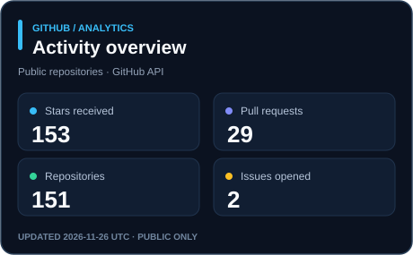
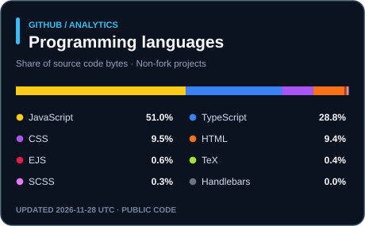

<h1 align="center">Hi, I'm Ahmed Basuony 👋</h1>

<h3 align="center">Full-Stack Developer · React / Next.js · Node.js / NestJS</h3>

  I build web apps, dashboards, APIs, booking systems, and e-commerce platforms.

  <a href="https://ahmed-basuony.vercel.app/">Portfolio</a> ·
  <a href="https://www.linkedin.com/in/ahmed-basuony-0654202a4/">LinkedIn</a> ·
  <a href="https://drive.google.com/file/d/1pDZUrN0vgukGKL-uaD6ttyO30-ajXXN4/view">Resume</a> ·
  <a href="mailto:ahmed.basouny.dev@gmail.com">Email</a>

## 🛠 Tech Stack

**Frontend:** React · Next.js · TypeScript · Tailwind CSS · Redux Toolkit · TanStack Query  
**Backend:** Node.js · Express.js · NestJS · REST APIs · Socket.IO · RabbitMQ  
**Databases:** MongoDB · PostgreSQL · TypeORM  
**DevOps & Testing:** Docker · GitHub Actions · Vercel · Jest · Playwright · Git

## ⚙️ GitHub Analytics

  
  

  Statistics from public GitHub activity · <a href="./.github/workflows/update-public-stats.yml">Updated daily</a> · Language percentages represent code bytes, not skill levels.

