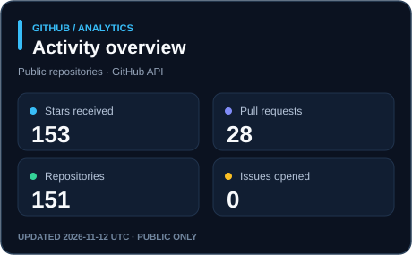

<h1 align="center">Hi, I'm Ahmed Basuony </h1>

<h3 align="center">Full Stack MERN Developer | React.js | Next.js | Node.js | NestJS</h3>

  I build scalable, user-focused web applications, dashboards, REST APIs, authentication systems, booking platforms, and e-commerce solutions.

  <a href="mailto:ahmed.basouny.dev@gmail.com">Email</a> •
  <a href="https://ahmed-basuony.vercel.app/">Portfolio</a> •
  <a href="https://www.linkedin.com/in/ahmed-basuony-0654202a4/">LinkedIn</a> •
  <a href="https://drive.google.com/file/d/1pDZUrN0vgukGKL-uaD6ttyO30-ajXXN4/view">Resume</a>

📞 &nbsp; Contact me: ahmed.basouny.dev@gmail.com | +966 51 186 1442

## 👨🏻‍💻 &nbsp;About Me  

  

    
  

  

    
  

 

💡 &nbsp; A passionate Full Stack MERN Developer based in Saudi Arabia, focused on building scalable and user-focused web applications.  
💻 &nbsp; Experienced in **MongoDB, Express.js, React.js, Node.js, Next.js, NestJS, TypeScript, REST APIs, and modern frontend architecture**.  
🚀 &nbsp; Skilled in building full-stack applications including authentication systems, dashboards, APIs, booking platforms, e-commerce systems, database design, and performance optimization.  
🧠 &nbsp; I care about clean code, maintainability, problem-solving, and building real product value.  
✍️ &nbsp; In my free time, I enjoy reading, improving my technical skills, and learning better ways to build software.

## 🛠 &nbsp;Tech Stack

### Frontend

  
  
  
  
  
  
  
  
  

### Backend & Databases

  
  
  
  
  
  

### Tools & DevOps

  
  
  
  
  
  
  
  
  

### ⚙️ &nbsp;GitHub Analytics

  
  

  Live source: GitHub API · Public activity only · <a href="./.github/workflows/update-public-stats.yml">Refreshed daily</a> · Language share is based on code bytes, not skill level.

